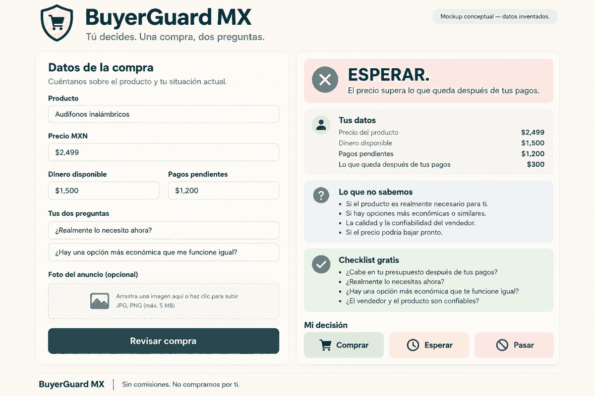
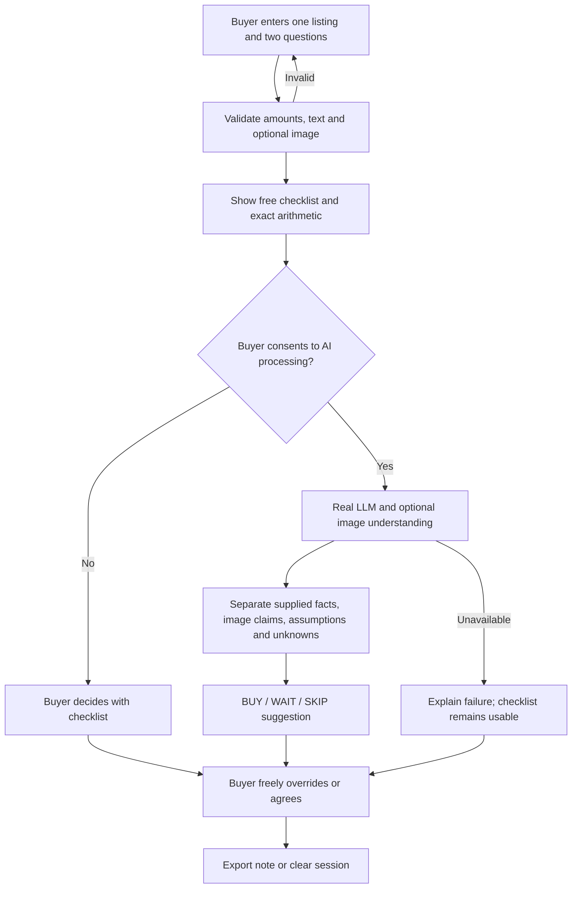
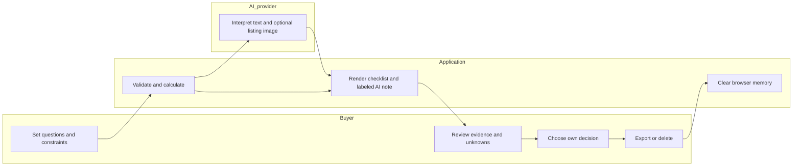

# BuyerGuard MX - Week 10 Packet
Author: Emiliano Carballido (USER). Prepared before application code, 18 October 2026.

## Problem, user, success
A Mexican shopper looking at one listing can be pushed toward checkout while product terms, money already committed, and unanswered questions disappear from view. The exact user is a Spanish-speaking Mexican shopper who wants a short pre-purchase note and retains the right to disagree. Before the module closes, the live app must accept one listing, two buyer-selected questions, MXN price and constraints, optionally read a listing image with real vision, and return a real LLM BUY / WAIT / SKIP explanation with unknowns and a freely chosen override.

Reference: BLUEPRINT_team week 10.pdf, supplied by the user. Its decisions remain marked proposed for team approval; this build implements Emiliano's declared slice, not an assertion of team ratification.

## Image-generated mockup

Generated with the built-in image generation tool before implementation. Concept only, not a screenshot or test result. Cream/teal, one intake and one decision card; actual limits and wording may change after testing.
Prompt: Spanish BuyerGuard MX desktop interface; one listing, two questions, price, available money, commitments, optional listing image, WAIT explanation, unknowns, free checklist, and equal BUY / WAIT / SKIP override buttons. No checkout or affiliate links.

## Feature flow

## Actor swimlane

## Benchmark
The best existing solution on Earth for intentional spending in this slice is YNAB, our selected benchmark rather than an objectively proven universal winner: its method asks people to assign money before spending (https://www.ynab.com/the-four-rules/ , researched 18 October 2026).
Mine differs by localizing a single-listing review to Spanish and MXN, two buyer-defined questions, explicit missing evidence, a free checklist and an unrestricted decision override; it does not replace a budget.

## Three-sentence long view
In three years, this could become a buyer-controlled evidence notebook for important purchases. It would compare documented terms with the buyer's own questions while preserving source provenance and explicit unknowns. Expansion would depend on voluntary checklist comparisons showing useful clarification without greater burden, never seller commissions or surveillance.

## Six conditions translated into acceptance criteria
1. Autonomy and shadow clause: buyer chooses two questions and final decision; no blocking, purchasing, profiling, persuasion, urgency or analytics. Equal override buttons; no penalty for disagreement.
2. Transparency: buyer entries are unverified; image text is an AI interpretation of a supplied source, not verified truth. Explicit sections for verified statements (none independently verified in MVP), buyer data, source claims, assumptions, contradictions and UNKNOWN. Arithmetic is deterministic; never infer accurate fit or guaranteed affordability.
3. Incentives: student prototype, no revenue, affiliate links, commissions, BNPL or seller ranking; disclose this in the UI.
4. Privacy: no accounts, database, credentials, linking or browser persistence. Keep data only in page memory until clear/refresh/close, export locally, and disclose that AI submissions go to Google with its separate policies. Free-tier provider processing may be used to improve products; use invented/non-sensitive examples and never upload identifying receipts. Do not promise deletion from provider logs.
5. Checklist comparison: free checklist usable without AI. Synthetic persona evidence is labeled; provide a blank five-willing-shopper protocol recording elapsed time, errors, clarifications and burden, without inventing participants or claiming reduced regret.
6. Capacity: one listing, two questions, one image up to 2 MB, bounded text and amounts, one request at a time, 25-second upstream timeout; disclose variable response time, free-tier quota and correction by editing/resubmitting.

## Scope cuts
No store, cart, purchase automation, seller recommendation, account, database, tracking, bank linking, historical price scraping, payment system, general chatbot, personalized feed or extra deployment. Vision is the third component; no additional price service is needed.

## Stack and architecture
| Layer | Minimal choice | Purpose |
|---|---|---|
| Interface | Static HTML, CSS, browser JavaScript | Accessible Spanish form, checklist, override, export/clear |
| Server | Vercel Node function | Validate and bound requests; keep API key server-only |
| LLM | Gemini free tier, configurable supported model | Explain two questions with structured output |
| User data | Manual ephemeral entries | Price, money before pending obligations, pending obligations, listing claims |
| Third Dragon component | Gemini image understanding | Read optional listing screenshot; label uncertain extraction |
| Hosting/source | Vercel free plan / GitHub | Exactly two explicit deployments and five commits |
| Evidence | Markdown, screenshots, PDF exports | Actual test and development records |

Browser -> same-origin API -> fixed Google endpoint -> schema-checked response. No fetching user URLs, no database and no personal data logs. Configure GEMINI_API_KEY in Vercel only; no keys in browser, repository or transcript. Missing key yields an honest unavailable error, never fake AI. Confirm free-tier eligibility/quotas before live tests; do not enable billing. Provider references: https://ai.google.dev/gemini-api/docs/pricing and https://ai.google.dev/gemini-api/docs/image-understanding .

## Security floor
Validate all text lengths, numeric types/ranges and image MIME/size on client and server; render output as text, never executable HTML. Bound output, timeout and concurrency; treat listing/prompt content as untrusted data. No personal storage means auth/RLS are not applicable; if storage is later introduced, add auth and per-user access first. Demos and screenshots use labeled invented data only. Add no-store and restrictive browser security headers.

## Test plan
Mechanical: valid request; blank and negative amounts; decimal arithmetic; obligations exceeding money; oversized/invalid image; overlong questions; malformed provider output; missing key, quota and timeout behavior; XSS-like input rendered inert; no persistent storage; override differs from AI; export and deletion. Use mocked provider responses only in explicitly identified automated tests, and separately verify actual text and vision calls live. Record an observed bug and its actual fix, then verify on deploy 2; never plant a bug.
Persona: fresh synthetic reviewer sees actual sequential screenshots as a Spanish-speaking price-conscious shopper, narrates confusion, and attempts the purchase task. Log exact observations, fix worst confusion, capture revised screen. This is not a real participant study.
Five willing shoppers (pending): each compares the free checklist and AI on the same invented case; alternate order; record seconds, errors, useful clarifications and self-rated burden (1-5), voluntary participation without names. Report only collected results and no causal claim about regret.

## Implementation prompt and exact commit/deploy plan
Build only this packet's slice. Acceptance: real text and image integration, bounded validated intake, explicit provenance/unknowns, independent checklist, freely chosen override, ephemeral data, export/clear, documented observed test/fix, persona evidence and three PDFs.
1. docs: packet before code (this file).
2. feat: minimal interface, checklist and generated mockup asset.
3. feat: validated real AI/vision endpoint and deployable configuration. Deploy 1.
4. fix: observed mechanical failure and worst persona confusion, with regression evidence. Deploy 2.
5. docs: final evidence, PDFs, demo guide and Session Close. No deployment for this docs-only commit.
No automatic Git deployments; explicit source-file deployments only. Update DECISIONS.md, record the next move, commit and push at session close. Never add commits or deployments merely to polish.

## Deliverables and honest limits
Live URL; GitHub repository; PACKET_Emiliano.pdf; PERSONA_Emiliano.pdf; BUILDCHAT_Emiliano.pdf from actual development messages and tool evidence. User records DEMO_Emiliano.mp4 (3 minutes + 30-second reflection); no fabricated recording or transcript. Five human shoppers and team ratification remain external requirements until actually performed.
