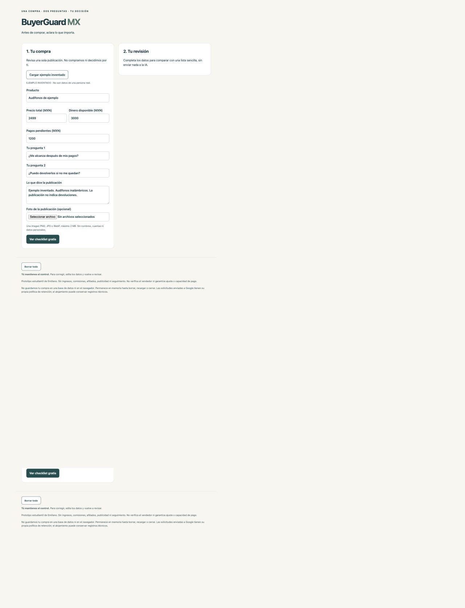
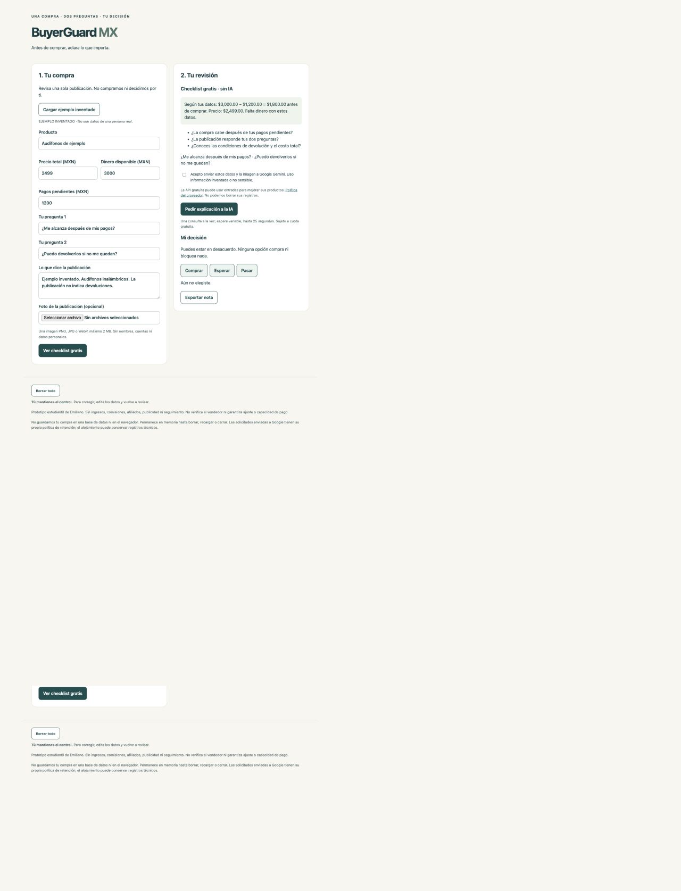

# PERSONA - Emiliano
Status: synthetic review completed; deployed fix verification pending API setup and deployment 2.

## Method and limits
A fresh-context synthetic reviewer inspected two actual sequential deployment-1 screenshots. Rosa, 45, is fictional: a cautious Mexican shopper who uses WhatsApp, reads slowly, has MXN 3000 before MXN 1200 pending payments, and considers MXN 2499 headphones. This is a screenshot walkthrough, not a real participant, autonomous browser session, or successful AI interaction.

## Exact synthetic narration
### Screen 1
“Revisaría los audífonos de $2,499. Tengo $3,000 y debo pagar $1,200. Pondría esos números, pero ‘Dinero disponible’ me hace dudar: ¿es todo lo que tengo o lo que queda después de pagar? Podría poner $1,800 y después volver a descontar los $1,200.

Dejaría las dos preguntas: si me alcanza y si puedo devolverlos. Copiaría lo que dice el anuncio. No subiría foto porque es opcional. Tocaría ‘Ver checklist gratis’, aunque no conozco bien la palabra ‘checklist’; entiendo que me mostrará una revisión.

Las letras pequeñas me cuestan trabajo. En esta captura también veo mucho espacio vacío y otra vez el botón y el pie de página; no entiendo si debo seguir bajando.”

### Screen 2
“Ahora entiendo la cuenta: me quedan $1,800 antes de comprar y no alcanza. Me ayudaría que dijera cuánto falta: $699.

Sobre devolverlos, veo preguntas y vuelvo a ver mis propias preguntas entre comillas. No encuentro una respuesta directa que diga que el anuncio no informa las devoluciones. Le preguntaría al vendedor antes de comprar.

Veo ‘Pedir explicación a la IA’, pero la casilla habla de enviar datos e imagen a Google Gemini. No sé qué significa ‘información inventada o no sensible’ para una compra mía; me detendría a leer antes de aceptarla.

En ‘Mi decisión’ elegiría ‘Esperar’. ‘Comprar’ me hace dudar si abre una compra, aunque el texto aclara que ninguna opción compra nada. Tampoco sé si ‘Pasar’ significa descartar estos audífonos o saltarme este paso. ‘Exportar nota’ no me dice si obtendré algo que pueda mandar por WhatsApp.”

## Worst confusion and minimal fix
The input label could cause double subtraction of commitments, changing the purchase assessment. Changed 'Dinero disponible (MXN)' to 'Dinero que tienes antes de pagar pendientes (MXN)'. The remaining comments are recorded without expanding scope. Repeated footer/blank space in a full-page screenshot may be a capture artifact; no claim that this is a reproduced application bug.

## Checklist comparison - five willing shoppers pending
No human study has been conducted. Invite five willing shoppers, use invented cases and no names, alternate checklist-first/AI-first, record elapsed seconds, errors, useful clarifications and burden from 1 to 5. Five cases cannot prove reduced regret.

| Participant code | Order | Checklist seconds/errors/clarifications/burden | AI seconds/errors/clarifications/burden |
|---|---|---|---|
| P1 | Checklist first | Not collected | Not collected |
| P2 | AI first | Not collected | Not collected |
| P3 | Checklist first | Not collected | Not collected |
| P4 | AI first | Not collected | Not collected |
| P5 | Checklist first | Not collected | Not collected |
